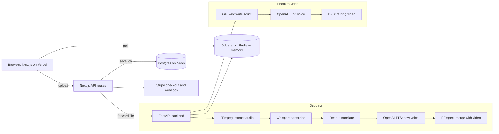

# VoiceOverAI

[](https://github.com/Siddhesh-Ai9797/VoiceOverAi/actions/workflows/ci.yml)

A full stack SaaS app for AI video. Upload a video and get it dubbed into another language, or upload a photo and a topic and get a talking head video. A Next.js frontend handles sign up, Stripe billing and job history. A FastAPI backend runs the AI pipelines and streams progress back to the browser.

## Features

| Feature | What it does |
|---|---|
| Video dubbing | Transcribe, translate, re-voice and re-mux any video up to 2 GB |
| Photo to video | Write a script with GPT-4o, voice it, and animate a photo with D-ID |
| 12 languages | Hindi, Tamil, Telugu, Bengali, Marathi, Spanish, French, German, Japanese, Mandarin, Korean, Arabic |
| Accounts | Email and password sign in with NextAuth and hashed passwords |
| Billing | Stripe checkout for three monthly plans, with a signed webhook that confirms payment |
| Live progress | The browser polls each job and shows the current pipeline step |

## How it works



**Dubbing.** FFmpeg pulls the audio out as 16 kHz mono WAV. Whisper turns speech into text, DeepL translates it, and OpenAI TTS reads it out in the new language. FFmpeg then puts the new audio back over the original video frames without re-encoding them.

**Photo to video.** GPT-4o writes a script about your topic, sized to the length you pick and in the language you choose. OpenAI TTS voices it. The photo is resized and sent to D-ID with the audio, and the backend polls D-ID until the talking video is ready.

**Jobs.** Each job runs in the background. Its status and progress live in Redis, or in memory during local development. The frontend polls every 2 seconds and shows each step as it finishes.

**Safety.** Uploads are checked by file type, job IDs must be UUIDs, and only known file extensions are kept, so a request cannot write files outside the upload folder.

## Plans

| Plan | Price | Minutes per month |
|---|---|---|
| Starter | $29 | 30 |
| Pro | $99 | 180 |
| Studio | $299 | Unlimited |

## Tech stack

| Area | Tools |
|---|---|
| Frontend | Next.js App Router, TypeScript, Tailwind CSS, NextAuth |
| Backend | FastAPI, FFmpeg, Redis |
| AI | OpenAI Whisper, GPT-4o and TTS, DeepL, D-ID |
| Data and billing | Postgres on Neon, Stripe |
| Deployment | Vercel, Render, Docker, GitHub Actions |

## Project structure

```
src/
  app/
    page.tsx              Upload and dubbing screen
    create/               Photo to video screen
    dashboard/            Job history
    pricing/              Stripe plans
    signin/, signup/      Auth pages
    api/
      dub/, create/       Create jobs and forward files to the backend
      jobs/[id]/          Job status
      checkout/           Stripe checkout session
      webhook/            Stripe webhook
      auth/, signup/      NextAuth and registration
  components/             Drop zone, language picker, live pipeline status
  lib/                    Auth config, database helpers, API client
backend/
  main.py                 FastAPI app, job store and endpoints
  pipeline.py             Dubbing pipeline
  create_pipeline.py      Photo to video pipeline
  tests/                  Backend tests
  Dockerfile              Backend image with FFmpeg
```

## Running it

You need Node 20, Python 3.11 or newer, and FFmpeg.

Create `.env.local` in the project root:

```
DATABASE_URL=postgres://...
OPENAI_API_KEY=...
DEEPL_API_KEY=...
DID_API_KEY=...
STRIPE_SECRET_KEY=...
STRIPE_WEBHOOK_SECRET=...
AUTH_SECRET=...
NEXT_PUBLIC_API_URL=http://localhost:8000
NEXT_PUBLIC_APP_URL=http://localhost:3000
```

Then start both servers:

```bash
npm install
npm run dev
```

```bash
cd backend
pip install -r requirements.txt
uvicorn main:app --reload --port 8000
```

Open http://localhost:3000. The backend can also run in Docker:

```bash
docker build -t voiceoverai-backend backend
docker run -p 8000:8000 --env-file .env.local voiceoverai-backend
```

## Tests

```bash
cd backend
pip install -r requirements.txt pytest
python -m pytest -q
```

The 10 backend tests stub the AI services and cover job creation, status polling, downloads, file type checks and upload path safety. GitHub Actions runs them on every push, along with the frontend type check, lint and the backend Docker build.

## Roadmap

* Update the user's plan and minutes from the Stripe webhook
* Real voice cloning so the dubbed voice matches the original speaker
* Lip sync on a GPU
* S3 storage for uploads and results
* Subtitle export
* Google and GitHub sign in

## Author

Siddhesh Patil, MS in Artificial Intelligence, DePaul University
